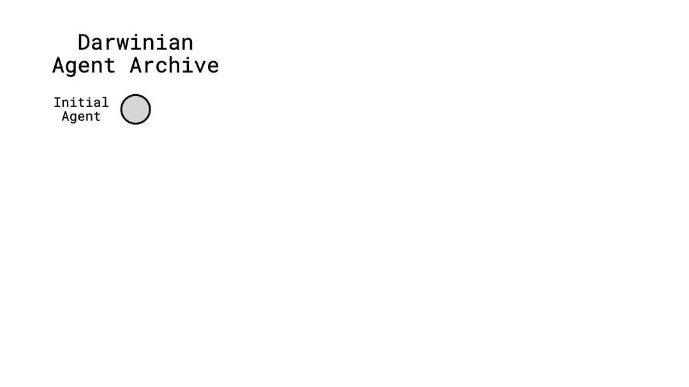

<h1 align="center">
    Darwin Gödel Machine:<br/>Open-Ended Evolution of Self-Improving Agents
</h1>

<p align="center">
  <a href="https://github.com/jennyzzt/dgm/blob/main/LICENSE"></a>
  <a href="https://arxiv.org/abs/2505.22954"></a>
  <a href="https://sakana.ai/dgm/"></a>
  <a href="https://x.com/SakanaAILabs/status/1928272612431646943"></a>
  <a href="https://drive.google.com/drive/folders/1Kcu9TbIa9Z50pJ7S6hH9omzzD1pxIYZC?usp=sharing"></a>
</p>


Repository for **Darwin Gödel Machine (DGM)**, a novel self-improving system that iteratively modifies its own code (thereby also improving its ability to modify its own codebase) and empirically validates each change using coding benchmarks.

<p align="center">
  
</p>
<!-- <p align="center">
</a><br>
</p> -->


## Setup
```bash
# API keys, add to ~/.bashrc
export OPENAI_API_KEY='...'
export ANTHROPIC_API_KEY='...'
# Optional: OpenRouter / Deepseek
export OPENROUTER_API_KEY='...'
export DEEPSEEK_API_KEY='...'

# Local Model Options (choose one or more):

## Option 1: Local endpoints for LocalAI / Ollama (OpenAI-compatible)
export LOCALAI_BASE_URL='http://localhost:8080/v1'   # default if unset
export LOCALAI_API_KEY='localai'                      # Optional: default if unset
export OLLAMA_BASE_URL='http://localhost:11434/v1'   # default if unset
export OLLAMA_API_KEY='ollama'                        # Optional: default if unset

## Option 2: Local file models via llama.cpp
export LLAMA_CPP_MODEL_PATH='/abs/path/to/model.gguf'
export LLAMA_CPP_N_CTX=8192
export LLAMA_CPP_N_GPU_LAYERS=0  # Set to higher values to use GPU acceleration
export LLAMA_CPP_CHAT_FORMAT='llama-3'  # Options: llama-3, chatml, vicuna, etc.

## Option 3: Hugging Face models (automatically downloaded)
export HF_N_CTX=8192
export HF_N_GPU_LAYERS=0  # Set to higher values to use GPU acceleration
export HF_CHAT_FORMAT='llama-3'  # Options: llama-3, chatml, vicuna, etc.
```

```bash
# Verify that Docker is properly configured in your environment.
docker run hello-world
 
# If a permission error occurs, add the user to the Docker group
sudo usermod -aG docker $USER
newgrp docker
```

## Using Local AI Models

DGM now supports running with local AI models in addition to cloud API-based models. This gives you more flexibility, privacy, and potentially lower costs for running the system.

### Available Local Model Options

1. **LocalAI**: An OpenAI API-compatible interface for running local models
   - Setup: Follow instructions at [LocalAI GitHub](https://github.com/mudler/LocalAI)
   - Configure using `LOCALAI_BASE_URL` and `LOCALAI_API_KEY` environment variables

2. **Ollama**: Easy setup for running LLMs locally
   - Setup: Install from [Ollama.ai](https://ollama.ai/)
   - Pull models with `ollama pull llama3` or other model names
   - Configure using `OLLAMA_BASE_URL` and `OLLAMA_API_KEY` environment variables

3. **Direct GGUF Models via llama.cpp**:
   - Download a GGUF model file
   - Set `LLAMA_CPP_MODEL_PATH` to the absolute path of your model file, or set `GGUF_MODEL_DIR` to a directory containing your GGUF models for automatic discovery.
   - Configure context size and GPU acceleration as needed

4. **Hugging Face Models**:
   - Use models directly from Hugging Face Hub with the `hf/` prefix
   - Example: `hf/TheBloke/Llama-3.1-8B-Instruct-GGUF` or `hf/TheBloke/Mistral-7B-Instruct-v0.2-GGUF`
   - Models are automatically downloaded and cached locally
   - Configure with `HF_N_CTX`, `HF_N_GPU_LAYERS`, and `HF_CHAT_FORMAT` environment variables

### GPU Acceleration

For better performance with local models:
- Install GPU-enabled versions of llama-cpp-python: `pip install llama-cpp-python-cuda` (NVIDIA) or `llama-cpp-python-rocm` (AMD)
- Set `LLAMA_CPP_N_GPU_LAYERS` or `HF_N_GPU_LAYERS` to a higher value (try 35 for 7B models, 60+ for larger models)

```bash
# Install dependencies
python3 -m venv venv
source venv/bin/activate
pip install -r requirements.txt

# Optional: for running analysis
sudo apt-get install graphviz graphviz-dev
pip install -r requirements_dev.txt
```

```bash
# Clone SWE-bench
cd swe_bench
git clone https://github.com/princeton-nlp/SWE-bench.git
cd SWE-bench
git checkout dc4c087c2b9e4cefebf2e3d201d27e36
pip install -e .
cd ../../

# Prepare Polyglot
# Make sure git is properly configured in your environment with username and email
python -m polyglot.prepare_polyglot_dataset
```

## Running the DGM
```bash
python DGM_outer.py
```
By default, outputs will be saved in the `output_dgm/` directory.

### Using Local models (LocalAI or Ollama servers)
The LLM layer supports any OpenAI-compatible server. You can select a model via:
- CLI: `--model <provider/model>`
- Environment variable: `DGM_MODEL` (fallback)

Providers:
- LocalAI: prefix `localai/`, e.g. `localai/llama-3.1-8b-instruct`
  - Server default: http://localhost:8080/v1 (override with LOCALAI_BASE_URL)
- Ollama: prefix `ollama/`, e.g. `ollama/llama3.2`
  - Server default: http://localhost:11434/v1 (override with OLLAMA_BASE_URL)

Environment variables (optional):
```bash
export LOCALAI_BASE_URL='http://localhost:8080/v1'
export LOCALAI_API_KEY='localai'
export OLLAMA_BASE_URL='http://localhost:11434/v1'
export OLLAMA_API_KEY='ollama'
```

Examples:
```bash
# Run coding agent with LocalAI (LocalAI server must be running)
export DGM_MODEL='localai/llama-3.1-8b-instruct'
python coding_agent.py --problem_statement "..." --git_dir /path/to/repo \
  --base_commit <sha> --chat_history_file ./chat_history.md

# Or specify on CLI
python coding_agent.py --problem_statement "..." --git_dir /path/to/repo \
  --base_commit <sha> --chat_history_file ./chat_history.md \
  --model localai/llama-3.2-3b-instruct

# Run with Ollama
python coding_agent.py --problem_statement "..." --git_dir /path/to/repo \
  --base_commit <sha> --chat_history_file ./chat_history.md \
  --model ollama/llama3.2
```

### Using Local model files directly (no server)
You can run GGUF models locally using llama.cpp via llama-cpp-python. Either:
- Set `DGM_MODEL="llama-cpp/<absolute_path_to_model.gguf>"`, or
- Set `LLAMA_CPP_MODEL_PATH` environment variable and use `DGM_MODEL=llama-cpp`.
- **New: Automatic GGUF Model Discovery**: Set `GGUF_MODEL_DIR` to a directory containing your GGUF models. DGM will automatically discover and load models from this directory. To use a discovered model, set `DGM_MODEL=<model_name_without_gguf_extension>`.

Optional tuning via env vars:
- `LLAMA_CPP_N_CTX` (default 8192)
- `LLAMA_CPP_N_GPU_LAYERS` (default 0)
- `LLAMA_CPP_CHAT_FORMAT` (default "llama-3")

Examples:
```bash
# Directly in the model string
python coding_agent.py --problem_statement "..." --git_dir /path/to/repo \
  --base_commit <sha> --chat_history_file ./chat_history.md \
  --model "llama-cpp/C:/models/llama-3.2-3b-instruct.Q4_K_M.gguf"

# Using environment variable
set LLAMA_CPP_MODEL_PATH=C:\\models\\llama-3.2-3b-instruct.Q4_K_M.gguf
python coding_agent.py --problem_statement "..." --git_dir /path/to/repo \
  --base_commit <sha> --chat_history_file ./chat_history.md \
  --model llama-cpp
```

Quickstart for LocalAI:
- Docker compose and packaged images: see coleam00/local-ai-packaged
- Upstream project: mudler/LocalAI
- Ensure the server exposes an OpenAI-compatible endpoint, e.g. http://localhost:8080/v1

Note: For models without native tool-calling, the agent falls back to manual tool use via prompts (<tool_use> blocks), so LocalAI/Ollama and llama-cpp can still execute tools.

## File Structure
- `analysis/` scripts used for plotting and analysis
- `initial/` SWE-bench logs and performance of the initial agent
- `initial_polyglot/` Polyglot logs and performance of the initial agent
- `swe_bench/` code needed for SWE-bench evaluation
- `polyglot/` code needed for Polyglot evaluation
- `prompts/` prompts used for foundation models
- `tests/` tests for the DGM system
- `tools/` tools available to the foundation models
- `coding_agent.py` main implementation of the initial coding agent
- `DGM_outer.py` entry point for running the DGM algorithm

## Logs from Experiments
This [google drive folder](https://drive.google.com/drive/folders/1Kcu9TbIa9Z50pJ7S6hH9omzzD1pxIYZC?usp=sharing) contains all the foundation model output logs from the experiments shown in the paper.

## Safety Consideration
> [!WARNING]  
> This repository involves executing untrusted, model-generated code. We strongly advise users to be aware of the associated safety risks. While it is highly unlikely that such code will perform overtly malicious actions under our current settings and with the models we use, it may still behave destructively due to limitations in model capability or alignment. By using this repository, you acknowledge and accept these risks.

## Acknowledgement

The evaluation framework implementations are based on the [SWE-bench](https://github.com/swe-bench/SWE-bench) and [polyglot-benchmark](https://github.com/Aider-AI/polyglot-benchmark) repositories.

## Citing
If you find this project useful, please consider citing:
```bibtex
@article{zhang2025darwin,
  title={Darwin Godel Machine: Open-Ended Evolution of Self-Improving Agents},
  author={Zhang, Jenny and Hu, Shengran and Lu, Cong and Lange, Robert and Clune, Jeff},
  journal={arXiv preprint arXiv:2505.22954},
  year={2025}
}
```
